# 07 — User Flows (CFO MVP)

> **Phiên bản 1.2 (06/11/2026):** bỏ `MANUAL_PLANNING`/`HANDLED_EXTERNALLY`; luồng 12a thành **đơn nhiều xe**; thêm luồng 12b **gợi ý lập lại tự động**; tạm dừng/tiếp tục chuẩn bị; giữ chỗ chỉ khóa khi duyệt.
>
> Lịch sử **v1.1:** bỏ thiết bị kho; thêm luồng xử lý ngoài CFO (12a); làm rõ đóng kế hoạch khi lập lại/hủy/xếp lại; khóa đồng thời khi giữ chỗ và duyệt; POD theo từng lần giao.
>
> Luồng người dùng và luồng hệ thống, mô tả bằng bước đánh số và sơ đồ Mermaid. Mỗi luồng có tác nhân, điều kiện đầu, các bước chính, nhánh ngoại lệ, kết quả và màn hình liên quan (`03_UI_UX_Specification.md`), endpoint (`06`), quy tắc (`BR-…` ở `01`). Trạng thái đơn theo `05`. Agent code dùng tài liệu này để dựng điều hướng, kiểm tra thứ tự thao tác và viết test E2E.

## 0. Quy ước

- **Tác nhân:** SALES (POS giả lập), SYS (hệ thống/job), IT, DISP (dispatcher), WH (quản lý/trưởng ca kho), DRV (tài xế), CS (chăm sóc khách hàng), CUS (khách, nhận email/SMS).
- Trạng thái đơn: `SUBMITTED`, `BLOCKED_UNMAPPED_SKU`, `PLANNED`, `NO_FEASIBLE_DATE`, `APPROVED`, `PREPARING`, `GOODS_READY`, `LOADED`, `DISPATCHED`, `DELIVERED`, `FAILED`, `CANCELLED`.
- Mọi nút ghi có `Idempotency-Key`; mọi quyết định ghi `decision_log`.

## 1. Bản đồ tổng thể: từ nhập đơn đến nhận hàng

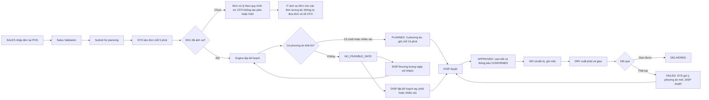

## 2. Luồng nhập đơn và kéo về CFO

**Tác nhân:** SALES, SYS · **Màn:** POS giả lập (5.5), Order queue (5.1) · **Quy tắc:** BR-ORD-01..04, FR-INT-02/04

1. SALES mở POS, chọn khách và địa chỉ giao (danh sách seed có toạ độ), chọn **dạng ngày** (Exact/Range/Latest), nhập khung giờ nhận (tùy chọn), yêu cầu đặc biệt, thêm dòng hàng (SKU, số lượng).
2. Bấm **Submit for CFO planning**: POS gọi `validate` (khách, địa chỉ/toạ độ, dòng hàng > 0, dạng ngày hợp lệ, ngày làm việc, khung giờ nằm trong giờ của điểm giao). Lỗi → hiện lỗi từng trường, không nộp. Thành công → `submit` → `SUBMITTED_FOR_PLANNING`.
3. SYS (`ingest_orders`, 5 phút) kéo đơn theo `updated_since`, upsert theo `(market_id, external_ref)`; dòng lỗi vào reject.
4. SYS đánh giá **100% SKU đã mapping confirmed** trước khi đưa đơn vào luồng CFO. Nếu đủ: nạp `customer_order` `SUBMITTED`, chụp địa chỉ/toạ độ, lập kế hoạch (luồng 4). Nếu thiếu: đơn đi theo quy trình cũ; CFO không chạy planning/hold/approve. Không tạo cam kết CFO khi nguồn sở hữu luồng chưa xác minh được.
5. Nếu nguồn sửa đơn **trước khi duyệt**: đơn được cập nhật, `version + 1`, lập kế hoạch lại tự động; **sau khi duyệt**: chỉ tạo alert (luồng 13).

**Nhánh:** Nếu thiếu SKU đã xác nhận, Sales tiếp tục quy trình cũ (không chặn thao tác trên POS), CFO chỉ báo không đủ điều kiện điều phối và **không lập plan/hold**. IT vẫn mapping dần danh mục; đơn đã đi theo quy trình cũ không tự chuyển sang CFO sau mapping.

## 2a. Sales xác nhận tại quầy bằng CFO riêng

1. Sales tạo/submit đơn trong POS cũ, không thay POS. 2. Sales mở CFO, nhập mã đơn nguồn và bấm `Sync now`; CFO GET nguồn qua adapter và upsert đơn. 3. Sales bấm `Check feasibility`; CFO lập phương án mặc định + hold 15 phút. 4. Nếu đủ điều kiện Sales (rank 1, 5 gate pass, safe, một xe, đúng cửa hàng, nguồn mới, không gây chậm đơn cũ), Sales bấm `Confirm`. 5. ApprovalService kiểm tra/khóa/commit nguồn lực, ghi actor và chuyển APPROVED. Chỉ lúc này mới thông báo cam kết cho khách. Nếu không đạt → Retry/Dispatcher. Polling 5 phút vẫn dự phòng; không ghi ngược POS.

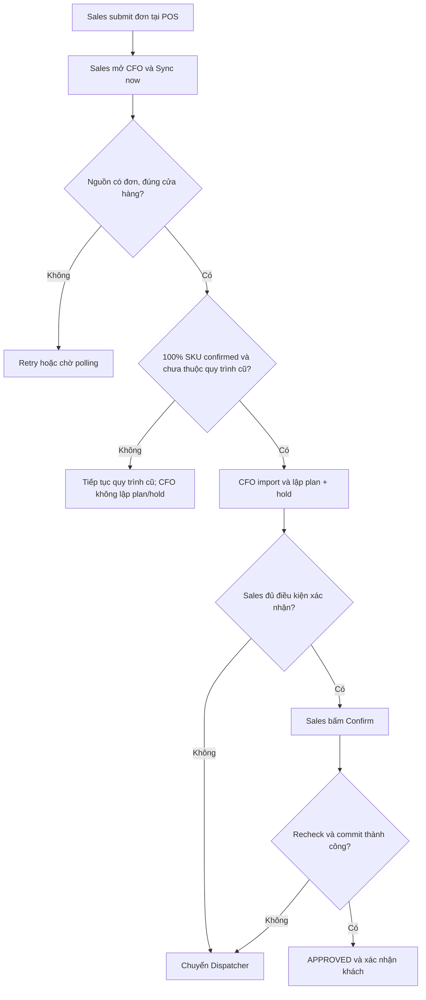

## 3. Luồng ánh xạ SKU (IT)

**Tác nhân:** SYS, IT · **Màn:** Product mapping (5.A7) · **Quy tắc:** BR-PRD-01..03

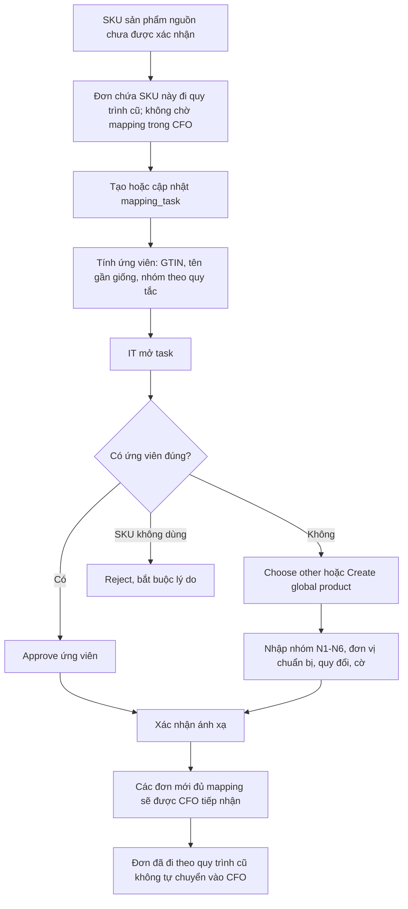

**Chi tiết:** (1) IT xem SKU chưa mapping và ứng viên; (2) tạo global mới với nhóm xử lý, `base_unit`, cân nặng/thể tích, đơn vị quy đổi và cờ; (3) xác nhận → `MAPPING_CONFIRMED` và SKU đủ điều kiện cho **các đơn mới**; (4) từ chối → lưu lý do tại task/audit. **Đơn đã chuyển sang quy trình cũ không được tự mở khóa, tự tạo plan/hold hay chuyển về CFO.**

## 4. Luồng lập kế hoạch (hệ thống)

**Tác nhân:** SYS · **Quy tắc:** BR-ATP, BR-PRP, BR-DEL, BR-GATE, BR-RNK, BR-RES

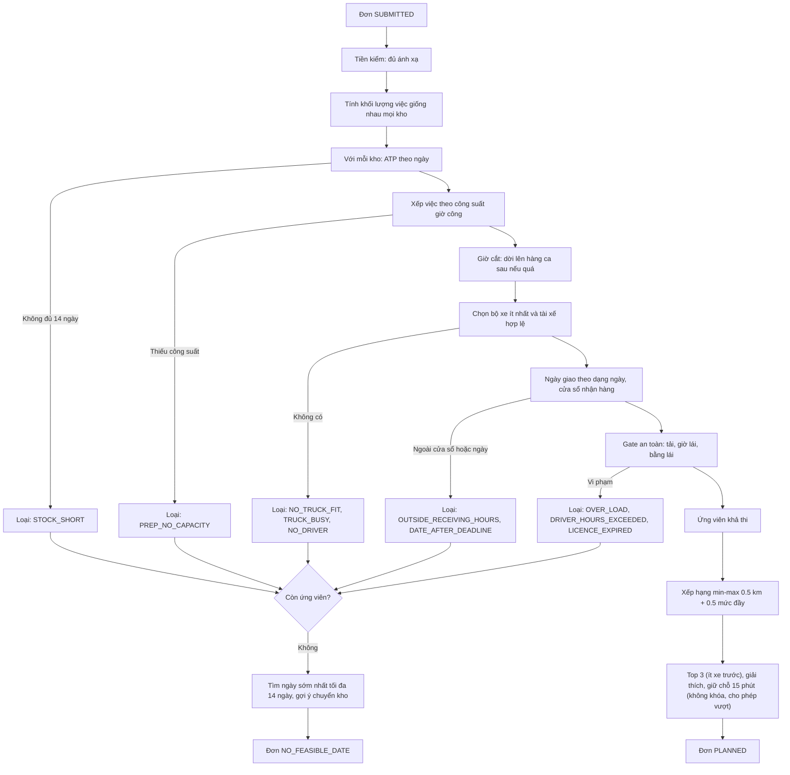

## 5. Luồng duyệt kế hoạch (Dispatcher đầy đủ; Sales nhánh tiêu chuẩn mục 2a)

**Tác nhân:** DISP · **Màn:** Plan review (5.2) · **Quy tắc:** BR-APR, BR-RES

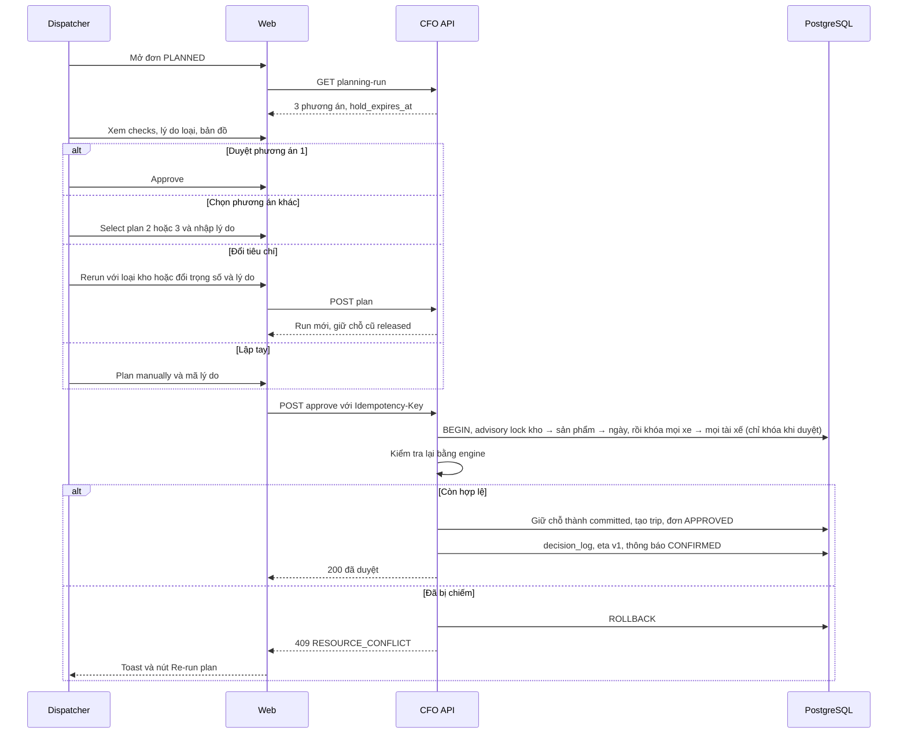

**Chi tiết bổ sung**
1. Nếu `reserve_class = tight`: bắt buộc tick "I accept the tight schedule" trước khi Approve.
2. Hold hết hạn: chip đỏ nhạt; Approve vẫn thử (kiểm tra lại); nút **Extend** tối đa 2 lần mỗi lần 15 phút.
3. Duyệt phương án rank > 1: modal lý do bắt buộc (`ALT_SELECTED`).
4. Ngày cam kết khác ngày khách đã đồng ý: cần chọn bản ghi `date_negotiation.agreed`.
5. **Kết quả:** đơn `APPROVED`, `committed_date`, `promise_start/end`, `delivery_trip` + `trip_stop`, email/SMS `CONFIRMED`, các hold khác `released`.

## 6. Luồng không có ngày khả thi và thương lượng ngày

**Tác nhân:** DISP, CS (liên hệ nếu được giao), CUS · **Màn:** No feasible date (5.3) · **Quy tắc:** BR-RNK-04/05

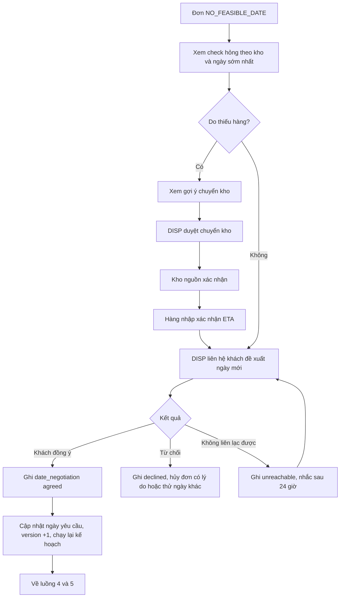

**Quy tắc cứng:** hệ thống **không bao giờ** tự đổi ngày yêu cầu; chỉ khi có bản ghi `agreed` (người, kênh, giờ) mới đổi. **Chuyển kho:** `suggested → approved (DISP) → source_confirmed (quản lý kho nguồn) → received (kho đích)`; sau `source_confirmed` hàng được tính như hàng nhập đã xác nhận; kho đích vẫn xử lý trọn đơn.

## 7. Luồng khai báo năng lực kho hằng ngày

**Tác nhân:** WH, SYS · **Màn:** Attendance & shifts (5.A5), Prep queue (5.6) · **Quy tắc:** BR-PRP-02/03/05, BR-EMP

1. SYS sinh điểm danh `planned` cho 14 ngày tới từ ca mẫu của kho.
2. Đầu ca, WH mở **Attendance & shifts** cho hôm nay → bấm **All present**, rồi đánh dấu người vắng/nghỉ → công suất ngày tự tính lại (số có mặt × giờ hữu ích × 90%).
3. Khi ca thực tế khác kế hoạch: WH ghi `SHIFT_CHANGE` (số người, ghi chú). SYS tính lại ETA các đơn có giữ chỗ ngày đó và báo DISP nếu có rủi ro.
4. Thay đổi nhân sự dài hạn do IT xử lý (chuyển công tác, thôi việc); công nhân kho **không có tài khoản**.

## 8. Luồng chuẩn bị hàng và bốc xếp (kho)

**Tác nhân:** WH, SYS · **Màn:** Prep queue (5.6) · **Quy tắc:** BR-EXE-01, FR-EXE-01

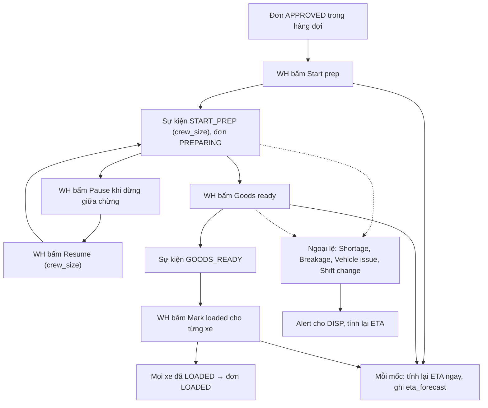

**Quy tắc:** không có bước duyệt; `START_PREP` và `PREP_RESUMED` bắt buộc nhập số người làm (`crew_size`); `PREP_PAUSED` khi dừng giữa chừng (đơn vẫn `PREPARING`); khi `GOODS_READY`, hệ thống cộng các đoạn làm việc thành giờ nhân công thực tế, chia theo nhóm hàng và đơn vị cơ sở để làm dữ liệu cho AI; mỗi sự kiện nhận `occurred_at` (mặc định giờ bấm, sửa được bằng popover "Happened at"); sai thứ tự → lỗi `ILLEGAL_TRANSITION`; `SHORTAGE` không tự sửa tồn kho (chỉ cảnh báo); `VEHICLE_ISSUE` gắn cờ xe để DISP cân nhắc lập lại.

## 9. Luồng giao hàng của tài xế (PWA) và GPS

**Tác nhân:** DRV, SYS, DISP · **Màn:** Driver (5.10), Tracking (5.4) · **Quy tắc:** BR-EXE, BR-GPS-01

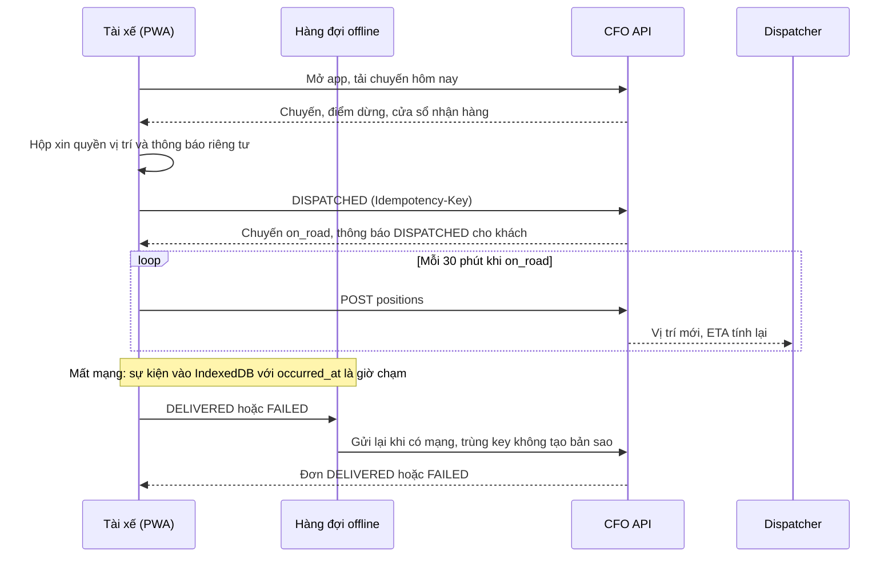

**Chi tiết**
1. Trước khi gửi GPS lần đầu: thông báo "gửi vị trí cho dispatcher mỗi 30 phút, khách không thấy, xóa sau 30 ngày" và xin quyền vị trí. Từ chối → app vẫn dùng được cho các mốc (không có GPS), dispatcher thấy "Location off".
2. `DELIVERED`: bắt buộc **Received by**; ghi chú tùy chọn. Mỗi lần giao (mỗi `trip_stop`) có một bản ghi POD riêng. `FAILED`: bắt buộc **Failure reason** (customer absent, site inaccessible, refused, wrong address, vehicle breakdown, goods damaged, other).
3. Khi `gps_enabled = false` hoặc chưa `on_road`, API từ chối vị trí; app im lặng thôi gửi.
4. Mất tín hiệu > 60 phút: SYS tạo alert `GPS_LOST` cho DISP.
5. Khi demo, `tools/gps_simulator.py` gửi vị trí dọc tuyến mỗi 1–2 phút với `source=simulator`.

## 10. Luồng theo dõi rủi ro và báo trễ cho khách

**Tác nhân:** SYS, DISP, CUS · **Màn:** Order queue, Tracking (5.1, 5.4), Notification inbox (5.8) · **Quy tắc:** BR-RSK-01/02, BR-NOT-02

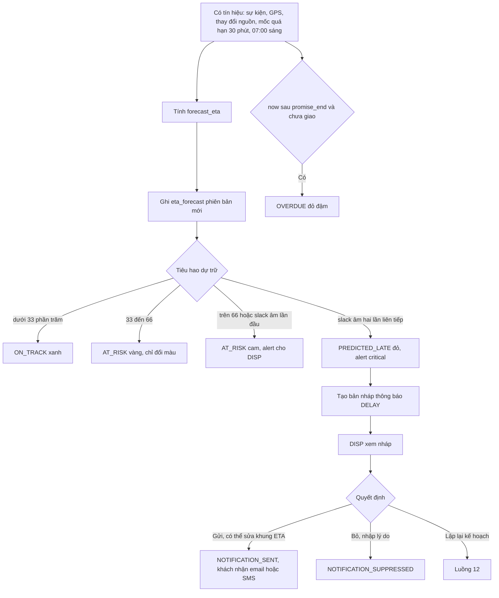

**Quy tắc:** chỉ DISP gửi báo trễ; sau khi gửi, bản nháp mới chỉ xuất hiện khi `forecast_eta` lệch ≥ 30 phút so với khung đã thông báo; không tính lại khi không có tín hiệu; khách chỉ nhận trạng thái và ETA.

## 11. Vòng đời thông báo

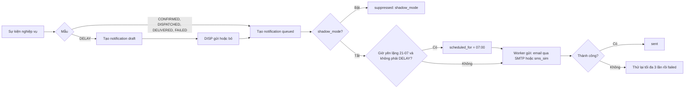

Mỗi thông báo có `dedupe_key` theo (đơn, mẫu, trạng thái). Nội dung dựng từ mẫu ở `03` mục 6; người nhận hiển thị đã che.

## 12. Luồng giao thất bại và lập lại

**Tác nhân:** DRV, SYS, DISP · **Quy tắc:** BR-EXE-02

1. DRV ghi `FAILED` + lý do chuẩn; chuyến `completed`; đơn `FAILED` khi mọi chuyến của đơn đã kết thúc và có xe thất bại; thông báo `FAILED` cho khách; alert cho DISP; **SYS gợi ý phương án mới** (luồng 12b).
2. DISP liên hệ khách (CS có thể hỗ trợ và ghi nhật ký), rồi duyệt phương án gợi ý, hoặc bấm **Replan this order** (lý do bắt buộc). Trong **một transaction**: kế hoạch cũ → `superseded`, giữ chỗ còn lại → `released`, ngày cam kết xóa (ghi vào nhật ký) → đơn `SUBMITTED` → luồng 4. POD của lần giao thất bại được giữ nguyên; lần giao sau có POD riêng.
3. Đơn FAILED không nằm trong mẫu số "đúng hạn", được đếm ở "tỷ lệ giao thất bại".
4. Lập lại một đơn **đã duyệt** vì thay đổi lớn (xe hỏng, khách đổi): cùng thao tác; kế hoạch cũ → `superseded`, giữ chỗ `committed` → `released`, `trip_stop`/`delivery_trip` → `cancelled` trước khi chạy lại. Khi duyệt kế hoạch mới, khách nhận `CONFIRMED` mới với ngày mới.
5. Hủy đơn (trước `DISPATCHED`) đóng kế hoạch, giữ chỗ, chuyến giống bước 4; đơn → `CANCELLED`.

## 12a. Luồng đơn lớn hơn một xe (nhiều xe, một kho)

**Tác nhân:** SYS, DISP, WH, DRV · **Màn:** Plan review (5.2), Prep queue (5.6), Driver (5.10) · **Quy tắc:** FR-ORD-05, BR-DEL-05, BR-RNK-02

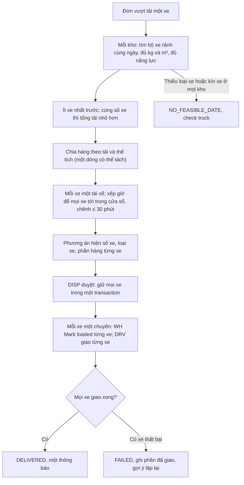

Không ghép đơn: một xe chỉ chở một đơn trong một chuyến. Không giới hạn số xe (chỉ bị giới hạn bởi xe và tài xế rảnh). Thông báo: một `CONFIRMED`, `DISPATCHED` khi xe đầu tiên xuất phát, `DELIVERED` khi xe cuối giao xong.

## 12b. Luồng gợi ý lập lại tự động

**Tác nhân:** SYS, DISP · **Màn:** Order queue (alert), Plan review (5.2) · **Quy tắc:** FR-APR-05, BR-APR-04

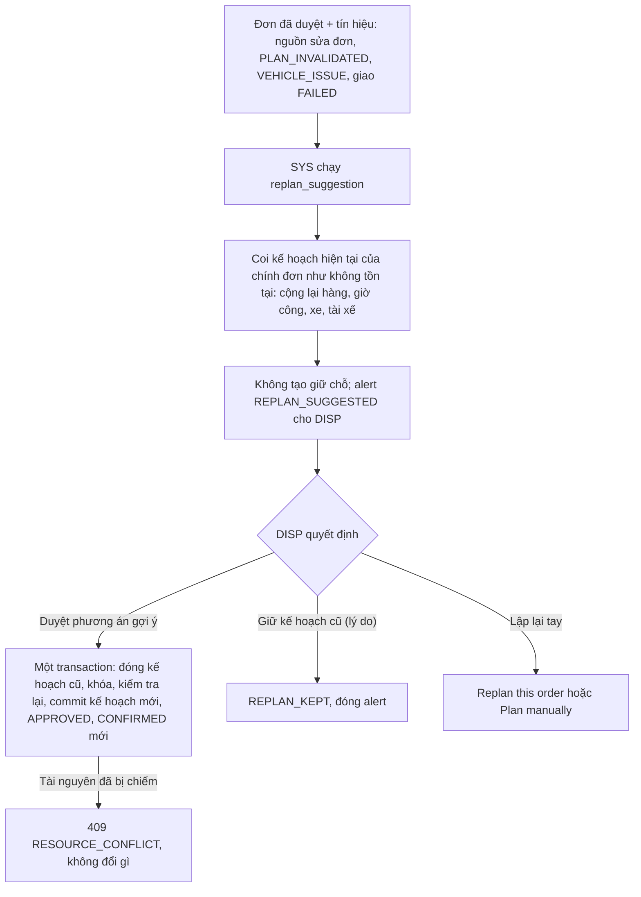

Không bao giờ tự duyệt. Đơn đã `DISPATCHED` chỉ nhận alert.

## 13. Luồng đơn thay đổi sau khi duyệt

1. SYS nhận phiên bản mới của đơn đã `APPROVED` từ nguồn (sửa số lượng, ngày, địa chỉ, hủy).
2. SYS **không ghi đè**; tạo alert `ORDER_CHANGED_AFTER_APPROVAL` kèm khác biệt và **tự gợi ý phương án mới** theo bản mới (luồng 12b).
3. DISP xem khác biệt và chọn: **duyệt phương án gợi ý**, **Keep current plan** (ghi lý do, đóng alert) hoặc **Cancel** (nếu nguồn hủy).
4. Đơn đã `DISPATCHED`: chỉ alert, không đổi trạng thái; DISP xử lý ngoài hệ thống.

## 14. Luồng đồng bộ dữ liệu và dữ liệu cũ

**Tác nhân:** SYS, IT · **Màn:** Data integration (5.9)

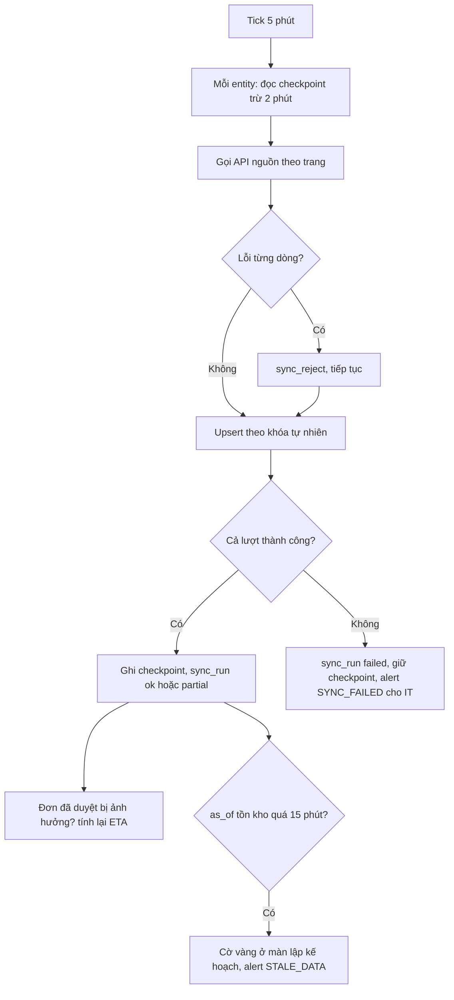

IT xem lượt chạy, dòng bị loại và có thể chạy tay (`/sync/{entity}/run`); **Upload CSV (fallback)** đi qua `CsvMarketAdapter` với kiểm tra hash để tránh nạp trùng.

## 15. Luồng CSKH tra cứu và ghi liên hệ

**Tác nhân:** CS · **Màn:** Order lookup (5.A14)

1. Khách gọi; CS tìm theo mã đơn, tên khách hoặc điện thoại.
2. CS xem trạng thái, khung giờ cam kết, ETA hiện tại, lịch sử thông báo (không GPS, không điểm số).
3. CS trả lời khách; ghi **Log a contact** (kênh, lý do, ghi chú).
4. Nếu khách yêu cầu đổi ngày hoặc có khiếu nại cần quyết định: CS chuyển cho DISP (ghi chú trong nhật ký liên hệ); CS **không** sửa kế hoạch, không gửi báo trễ.

## 16. Luồng thêm nước mới (IT)

1. IT chạy `tools/add_market.py <CC>` → dòng `ref.market`, bảng `ref.product_<cc>`, cập nhật view `ref.v_product_local`.
2. Cấu hình `MarketConfig` (ngày làm việc, giờ nhận hàng, giờ cắt, ngày lễ, ngôn ngữ, múi giờ, tiền tệ) trong màn Market config; `shadow_mode = true`.
3. Cấu hình `source_base_url` và khóa; nếu hệ thống nguồn không theo hợp đồng chuẩn thì viết lớp con của `RestMarketAdapter`.
4. Chạy đồng bộ sản phẩm → hàng đợi mapping → IT ánh xạ.
5. Chạy bóng (`shadow_mode`): dispatcher vẫn quyết định; không gửi thông báo cho khách; đo baseline và KPI.
6. Go-live: tắt `shadow_mode`, huấn luyện, dispatcher giữ quyền duyệt cuối; chỉ sang nước tiếp theo khi KPI đạt và quyền truy cập dữ liệu được xác nhận. Không sửa lõi ở bất kỳ bước nào.

## 17. Sơ đồ trạng thái đơn hàng

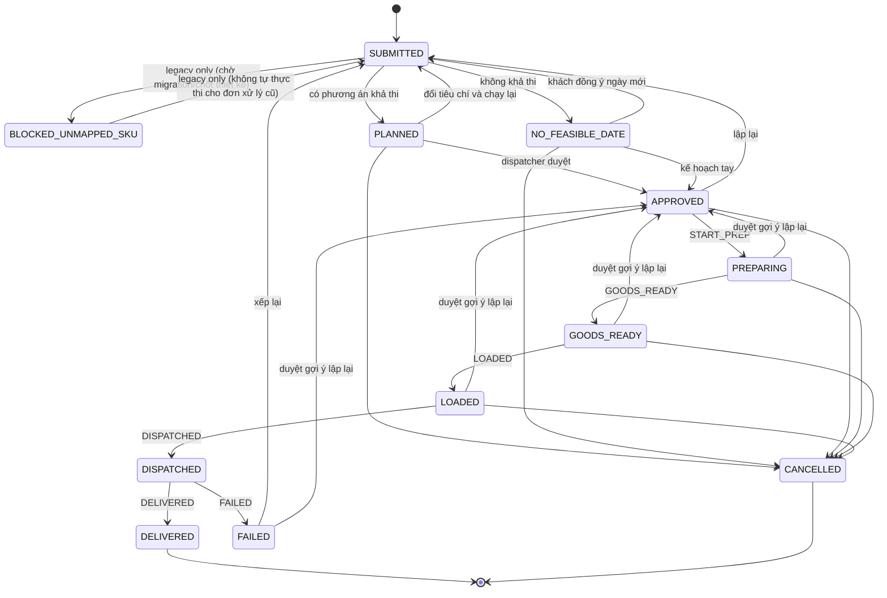

## 18. Ma trận điều hướng theo vai trò (điểm vào mặc định và bước tiếp)

| Vai trò | Sau đăng nhập | Việc thường gặp nhất | Bước tiếp thường dẫn đến |
|---|---|---|---|
| Dispatcher | Order queue | Mở đơn `PLANNED` → Plan review → Approve | Tracking & risk khi có cảnh báo; Exceptions khi có đơn không khả thi |
| Warehouse | Prep queue | Điểm danh → bấm mốc chuẩn bị → báo ngoại lệ | Attendance & shifts, Transfers |
| Driver | Today's trips | Mark dispatched → Delivered/Failed | — |
| Sales | My store orders / Sync & confirm trong CFO | Submit ở POS cũ, sync-now, check feasibility, confirm nếu đủ điều kiện | Thành công → APPROVED; ngoại lệ → Dispatcher |
| Store manager | My store orders | Theo dõi đơn; xem doanh thu cửa hàng mình nếu là owner | Revenue · my location |
| Customer service | Order lookup | Tra cứu, ghi liên hệ | — |
| IT/Admin | Data integration | Xử lý hàng đợi mapping, đồng bộ lỗi, nhân sự | Product mapping, Market config & GPS |
| Business owner (`revenue_all`) | Revenue | Xem doanh thu mọi cửa hàng và kho, xuất CSV | — |
| Project lead (`ops`) | KPIs & decision log | Xem KPI vận hành và nhật ký | — |

## 19. Tình huống ngoại lệ thường gặp và cách hệ thống phản ứng

| Tình huống | Phản ứng |
|---|---|
| Hai dispatcher duyệt cùng lúc hai đơn tranh một xe | Một thành công; người còn lại nhận `409 RESOURCE_CONFLICT` và nút Re-run plan |
| Hai đơn cùng tranh một lượng hàng (cùng kho, cùng SKU) hoặc cùng giờ công một ngày | Lúc lập kế hoạch cả hai được giữ chỗ (cho phép vượt); khi duyệt khóa theo (kho, sản phẩm) / (kho, ngày): đơn duyệt trước thắng, đơn sau nhận `409 RESOURCE_CONFLICT` |
| Đơn lớn hơn một xe | Tự xếp nhiều xe cùng kho, ít xe nhất (luồng 12a) |
| Thiếu loại xe cần (cẩu, ben) hoặc kín xe | `NO_FEASIBLE_DATE` (check `truck`); DISP thương lượng ngày, lập tay hoặc hủy |
| Hold hết hạn trong lúc dispatcher đang xem | Chip đỏ; Approve vẫn kiểm tra lại và thành công nếu tài nguyên còn trống |
| Tồn kho nguồn đổi sau khi duyệt | Kiểm tra lại các đơn đã duyệt bị ảnh hưởng; nếu kế hoạch không còn hợp lệ → alert `PLAN_INVALIDATED` + gợi ý phương án mới (luồng 12b) |
| Xe hỏng sau khi duyệt | `VEHICLE_ISSUE` → alert + gợi ý phương án mới (luồng 12b) |
| Tài xế mất mạng | Sự kiện xếp hàng, gửi lại một lần |
| ORS lỗi hoặc hết quota | Dùng ước lượng fallback có nhãn "Estimated route" (hoặc loại cặp nếu `routing.allow_fallback = false`) |
| Nguồn lỗi | `sync_run failed`, giữ checkpoint, alert IT; dispatcher thấy cờ dữ liệu cũ sau 15 phút |
| SMTP lỗi | Thử lại 3 lần rồi `failed`; DISP thấy trạng thái trong Notification inbox |
| Khách không liên lạc được khi thương lượng ngày | `unreachable`, nhắc sau 24 giờ |
