# 07 — User Flows (CFO MVP)

> **Phiên bản 1.2 (06/11/2026):** bỏ `MANUAL_PLANNING`/`HANDLED_EXTERNALLY`; luồng 12a thành **đơn nhiều xe**; thêm luồng 12b **gợi ý lập lại tự động**; tạm dừng/tiếp tục chuẩn bị; giữ chỗ chỉ khóa khi duyệt.
>
> Lịch sử **v1.1:** bỏ thiết bị kho; thêm luồng xử lý ngoài CFO (12a); làm rõ đóng kế hoạch khi lập lại/hủy/xếp lại; khóa đồng thời khi giữ chỗ và duyệt; POD theo từng lần giao.
>
> Luồng người dùng và luồng hệ thống, mô tả bằng bước đánh số và sơ đồ Mermaid. Mỗi luồng có tác nhân, điều kiện đầu, các bước chính, nhánh ngoại lệ, kết quả và màn hình liên quan (`03_UI_UX_Specification.md`), endpoint (`06`), quy tắc (`BR-…` ở `01`). Trạng thái đơn theo `05`. Agent code dùng tài liệu này để dựng điều hướng, kiểm tra thứ tự thao tác và viết test E2E.

> **Round 3 ([DEC-R3](decisions/DEC_R3_SCOPE_CRM_20261118.md)):** các luồng 2a, 5, 7, 8, 9, 10, 11, 12, 12a, 12b, 15, 17, 18 đã được viết lại theo DEC-R3-01 → 10.

## 0. Quy ước

- **Tác nhân:** SALES (POS giả lập), SYS (hệ thống/job), IT, DISP (dispatcher), WH (quản lý/trưởng ca kho), DRV (tài xế), CS (chăm sóc khách hàng), CUS (khách, nhận email/SMS).
- Trạng thái đơn: `SUBMITTED`, `BLOCKED_UNMAPPED_SKU`, `PLANNED`, `NO_FEASIBLE_DATE`, `APPROVED`, `PREPARING`, `GOODS_READY`, `LOADED`, `DISPATCHED`, `DELIVERED`, `FAILED`, `CANCELLED`.
- Mọi nút ghi có `Idempotency-Key`; mọi quyết định ghi `decision_log`.

## 1. Bản đồ tổng thể: từ nhập đơn đến nhận hàng

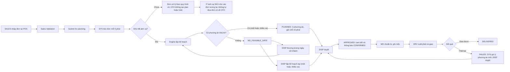

## 2. Luồng nhập đơn và kéo về CFO

**Tác nhân:** SALES, SYS · **Màn:** POS giả lập (5.5), Order queue (5.1) · **Quy tắc:** BR-ORD-01..04, FR-INT-02/04

1. SALES mở POS, chọn khách và địa chỉ giao (danh sách seed có toạ độ), chọn **dạng ngày** (Exact/Range/Latest), nhập khung giờ nhận (tùy chọn), yêu cầu đặc biệt, thêm dòng hàng (SKU, số lượng).
2. Bấm **Submit for CFO planning**: POS gọi `validate` (khách, địa chỉ/toạ độ, dòng hàng > 0, dạng ngày hợp lệ, ngày làm việc, khung giờ nằm trong giờ của điểm giao). Lỗi → hiện lỗi từng trường, không nộp. Thành công → `submit` → `SUBMITTED_FOR_PLANNING`.
3. SYS (`ingest_orders`, 5 phút) kéo đơn theo `updated_since`, upsert theo `(market_id, external_ref)`; dòng lỗi vào reject.
4. SYS đánh giá **100% SKU đã mapping confirmed** trước khi đưa đơn vào luồng CFO. Nếu đủ: nạp `customer_order` `SUBMITTED`, chụp địa chỉ/toạ độ, lập kế hoạch (luồng 4). Nếu thiếu: đơn đi theo quy trình cũ; CFO không chạy planning/hold/approve. Không tạo cam kết CFO khi nguồn sở hữu luồng chưa xác minh được.
5. Nếu nguồn sửa đơn **trước khi duyệt**: đơn được cập nhật, `version + 1`, lập kế hoạch lại tự động; **sau khi duyệt**: chỉ tạo alert (luồng 13).

**Nhánh:** Nếu thiếu SKU đã xác nhận, Sales tiếp tục quy trình cũ (không chặn thao tác trên POS), CFO chỉ báo không đủ điều kiện điều phối và **không lập plan/hold**. IT vẫn mapping dần danh mục; đơn đã đi theo quy trình cũ không tự chuyển sang CFO sau mapping.

## 2a. Sales duyệt tại quầy bằng CFO riêng (R3, DEC-R3-10)

1. Sales tạo/submit đơn trong POS cũ, không thay POS. 2. Sales mở CFO, nhập mã đơn nguồn và bấm `Sync now`; CFO GET nguồn qua adapter và upsert đơn. 3. Sales bấm `Check feasibility`; CFO lập 3 phương án + hold 15 phút. Sales có thể chạy lại với tiêu chí khác, hoặc ghi thỏa thuận ngày với khách. 4. Sales chọn phương án rank 1, 2 hoặc 3 (kho bất kỳ; rank 2–3 cần mã lý do). Chỉ cần phương án **khả thi** (qua 5 gate); không có tick lịch sát. 5. ApprovalService kiểm tra/khóa/commit nguồn lực, ghi actor và chuyển APPROVED; mọi chuyến gán một Dispatcher theo luân phiên. Chỉ lúc này mới thông báo cam kết cho khách. Không khả thi hoặc đơn cũ chưa duyệt đang tranh nguồn lực → chuyển Dispatcher. Polling 5 phút vẫn dự phòng; không ghi ngược POS.

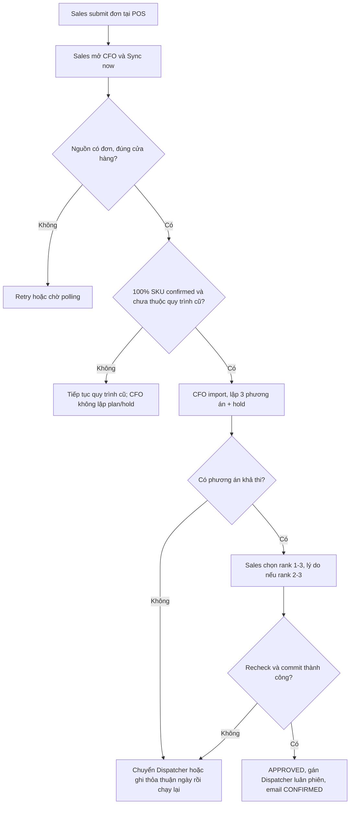

## 3. Luồng ánh xạ SKU (IT)

**Tác nhân:** SYS, IT · **Màn:** Product mapping (5.A7) · **Quy tắc:** BR-PRD-01..03

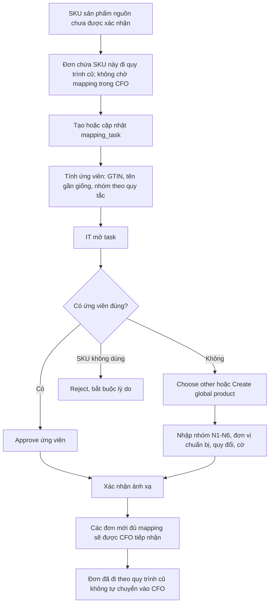

**Chi tiết:** (1) IT xem SKU chưa mapping và ứng viên; (2) tạo global mới với nhóm xử lý, `base_unit`, cân nặng/thể tích, đơn vị quy đổi và cờ; (3) xác nhận → `MAPPING_CONFIRMED` và SKU đủ điều kiện cho **các đơn mới**; (4) từ chối → lưu lý do tại task/audit. **Đơn đã chuyển sang quy trình cũ không được tự mở khóa, tự tạo plan/hold hay chuyển về CFO.**

## 4. Luồng lập kế hoạch (hệ thống)

**Tác nhân:** SYS · **Quy tắc:** BR-ATP, BR-PRP, BR-DEL, BR-GATE, BR-RNK, BR-RES

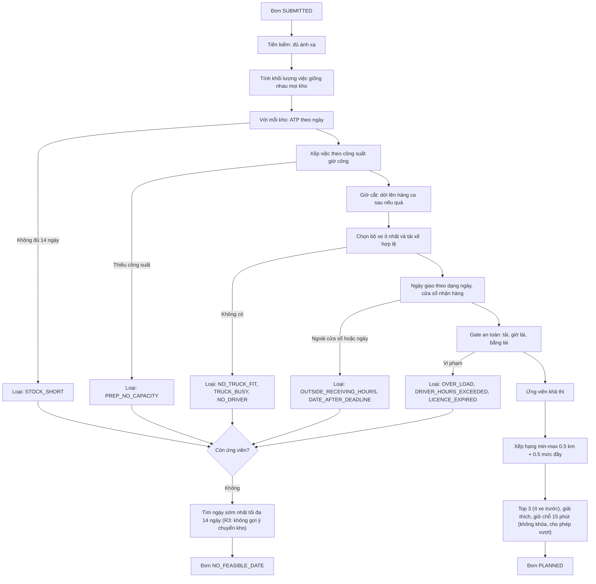

## 5. Luồng duyệt kế hoạch (Dispatcher; Sales cho đơn cửa hàng mình ở mục 2a)

**Tác nhân:** DISP · **Màn:** Plan review (5.2) · **Quy tắc:** BR-APR, BR-RES

```mermaid
sequenceDiagram
  participant D as Dispatcher
  participant UI as Web
  participant API as CFO API
  participant DB as PostgreSQL
  participant WMS as WMS reservation adapter (real disabled until approved)
  D->>UI: Mở đơn PLANNED
  UI->>API: GET planning-run
  API-->>UI: 3 phương án, hold_expires_at
  D->>UI: Xem checks, lý do loại, bản đồ
  alt Duyệt phương án 1
    D->>UI: Approve
  else Chọn phương án khác
    D->>UI: Select plan 2 hoặc 3 và nhập lý do
  else Đổi tiêu chí
    D->>UI: Rerun với loại kho hoặc đổi trọng số và lý do
    UI->>API: POST plan
    API-->>UI: Run mới, giữ chỗ cũ released
  else Lập tay
    D->>UI: Plan manually và mã lý do
  end
  UI->>API: POST approve với Idempotency-Key
  API->>DB: BEGIN, advisory lock kho → sản phẩm → ngày, rồi khóa mọi xe → mọi tài xế (chỉ khóa khi duyệt)
  API->>API: Kiểm tra lại bằng engine
  alt Năm gate còn hợp lệ và đủ phiên bản nguồn
    API->>WMS: Reserve exact native SKU, warehouse, quantity, idempotency key
    alt WMS ACK khớp đầy đủ và đã persist
      WMS-->>API: Verified reservation ACK
      API->>DB: Commit holds, create trips, APPROVED, audit, outbox CONFIRMED atomically
      API->>WMS: Immediate authoritative stock refresh/status read
      API-->>UI: Approved; stock verified from WMS
    else WMS failed/partial/unknown or no authorised live adapter
      WMS-->>API: Rejected/unknown; simulated ACK cannot guarantee real stock
      API->>DB: Do not finalize APPROVED; preserve/reconcile safe state
      API-->>UI: Reservation not verified; retry/status-check
    end
  else Gate/resource conflict
    API->>DB: ROLLBACK
    API-->>UI: 409 RESOURCE_CONFLICT
    UI-->>D: Toast và nút Re-run plan
  end
```

**Chi tiết bổ sung**
1. *(R3)* Không có tick lịch sát: phương án qua đủ 5 gate là duyệt được.
2. Hold hết hạn: chip đỏ nhạt, khóa Approve của hold cũ, backend từ chối `HOLD_EXPIRED`/409 kể cả nếu UI cũ vẫn gửi request; phải **Plan Again** và kiểm đủ gate trước khi tiếp tục. **Extend** chỉ khi hold còn hợp lệ, tối đa 2 lần mỗi lần 15 phút.
3. Duyệt phương án rank > 1: modal lý do bắt buộc (`ALT_SELECTED`).
4. Ngày cam kết khác ngày khách đã đồng ý: cần chọn bản ghi `date_negotiation.agreed`.
5. **Kết quả mục tiêu:** chỉ sau authoritative WMS ACK khớp SKU gốc/kho/số lượng, persist được và đọc tồn ngay sau ACK, đơn mới được coi stock-guaranteed/APPROVED, tạo trip, commit holds, audit và enqueue CONFIRMED trong transaction. **Code trên `main` còn thiếu WMS ACK và transactional notification enqueue; flow này chưa phải E2E hoàn tất.** Adapter simulated chỉ staging/demo, không xác nhận tồn thật.

## 6. Luồng không có ngày khả thi và thương lượng ngày

**Tác nhân:** DISP, CS (liên hệ nếu được giao), CUS · **Màn:** No feasible date (5.3) · **Quy tắc:** BR-RNK-04/05

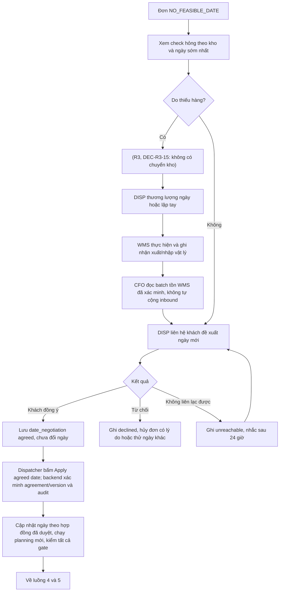

**Quy tắc cứng Q4/Q3:** lưu `date_negotiation.agreed` **chưa đủ để đổi ngày**: chỉ Dispatcher chọn `Apply agreed date` sau khi kiểm agreement/version/audit mới yêu cầu lập lại kế hoạch, không tự duyệt. CFO chỉ **gợi ý/yêu cầu** chuyển kho; WMS là nơi duy nhất xác nhận xuất/nhập vật lý. Không có giai đoạn `source_confirmed/received` do CFO click, không tự coi chuyển kho là hàng inbound khả dụng. Chỉ dùng snapshot/batch WMS mới, đầy đủ và đúng SKU, không cộng/trừ trùng.

## 7. Luồng khai báo năng lực kho hằng ngày (R3, DEC-R3-06)

**Tác nhân:** WH, SYS · **Màn:** Công suất ngày (form trong khu vực kho), Prep queue (5.6) · **Quy tắc:** BR-PRP-02, BR-PRP-06

1. Warehouse Manager mở form công suất ngày, chọn ngày → nhập từng ca: **số người làm** và **số giờ làm hữu ích** → Xác nhận. Lưu `warehouse_day_capacity` kèm người xác nhận, audit `CAPACITY_CONFIRMED`.
2. Công suất ngày = Σ ca (số người × số giờ) × `delivery_share` − việc đã đặt. Ngày lễ = 0. Ngày chưa xác nhận = 0, gate công suất fail.
3. Đổi số người/giờ: sửa dòng của ngày đó; ngày đã có dữ liệu hoặc ngày đã qua cần lý do (`CAPACITY_CHANGED`, before/after). SYS không tính lại ETA chỉ vì đổi công suất; đơn mới lập kế hoạch dùng số mới.
4. Không có lịch ca từng nhân viên, không có điểm danh, không có `attendance_gen`.

## 8. Luồng chuẩn bị hàng và bốc xếp (kho)

**Tác nhân:** WH, SYS · **Màn:** Prep queue (5.6) · **Quy tắc:** BR-EXE-01, FR-EXE-01, FR-EXE-04

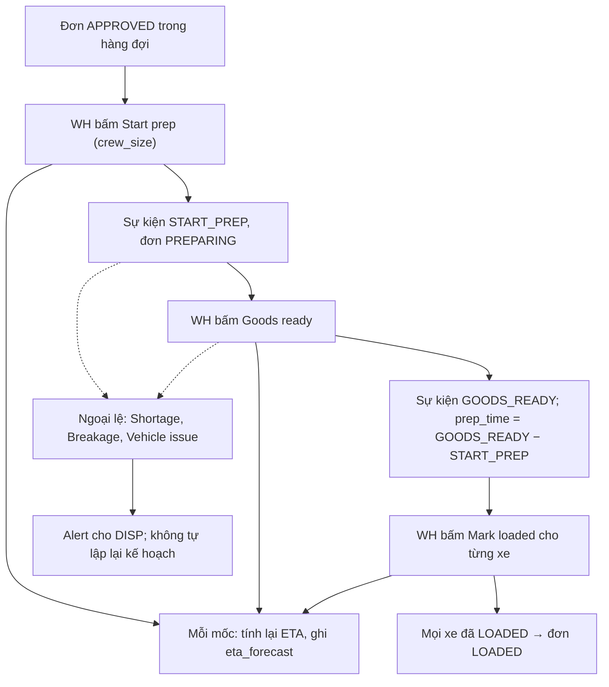

**Quy tắc:** không có bước duyệt; `START_PREP` bắt buộc `crew_size`; **không có tạm dừng/tiếp tục** (`PREP_PAUSED`/`PREP_RESUMED` → 422); thời gian chuẩn bị thực tế = GOODS_READY − START_PREP; mỗi sự kiện nhận `occurred_at` (mặc định giờ bấm, sửa được bằng popover "Happened at"); sai thứ tự → `ILLEGAL_TRANSITION`; `SHORTAGE` không tự sửa tồn kho (chỉ cảnh báo); `VEHICLE_ISSUE` chỉ tạo alert `EXCEPTION`, DISP tự quyết định.

## 9. Luồng giao hàng của tài xế và vị trí (R3, DEC-R3-01)

**Tác nhân:** DRV, SYS, DISP · **Màn:** Driver (5.10), danh sách chuyến của Dispatcher (dòng vị trí gần nhất) · **Quy tắc:** BR-EXE, BR-GPS-01

```mermaid
sequenceDiagram
  participant T as Tài xế (web, online)
  participant API as CFO API
  participant D as Dispatcher được gán
  T->>API: Mở trang, tải chuyến hôm nay
  API-->>T: Chuyến, điểm dừng, cửa sổ nhận hàng
  T->>T: Thông báo riêng tư và xin quyền vị trí
  T->>API: DISPATCHED (Idempotency-Key)
  API-->>T: Chuyến on_road; email DISPATCHED (xe đầu tiên của đơn)
  opt Tài xế chủ động
    T->>API: Cập nhật vị trí (một điểm)
    API-->>D: Vị trí gần nhất · Giờ cập nhật · ETA mới
  end
  opt Có sự cố
    T->>API: DRIVER_INCIDENT (lý do, vị trí nếu có)
    API-->>D: Alert sự cố; ETA mới hoặc "không xác định" nếu hỏng xe
  end
  T->>API: DELIVERED hoặc FAILED kèm vị trí (bắt buộc)
  API-->>T: POD; đơn DELIVERED/FAILED khi mọi chuyến kết thúc
```

**Chi tiết**
1. Trước lần gửi vị trí đầu: thông báo riêng tư cho tài xế (vị trí chỉ gửi khi tài xế bấm, khi báo sự cố và khi hoàn tất chuyến; chỉ Dispatcher được gán thấy khi chuyến đang chạy; tọa độ xóa khi đơn kết thúc; khách không thấy). Dùng với tài xế thật cần DPIA và tham vấn nhân viên.
2. `DELIVERED`: bắt buộc **Received by** và vị trí. `FAILED`: bắt buộc **Failure reason** và vị trí. Không lấy được vị trí (từ chối quyền, mất tín hiệu) → không xác nhận được; tài xế bật lại định vị hoặc gọi Dispatcher.
3. Không thu theo chu kỳ, không hàng đợi offline: lỗi mạng → "Thử lại" dùng lại cùng `Idempotency-Key`.
4. Quá ETA 30 phút mà chưa có `DELIVERED`/`FAILED` → alert `OVERDUE` cho Dispatcher được gán.
5. Dispatcher được gán theo luân phiên khi duyệt; bàn giao chuyến có audit.

## 10. Luồng theo dõi rủi ro và báo trễ cho khách

**Tác nhân:** SYS, DISP, CUS · **Màn:** Order queue, Tracking (5.1, 5.4), Notification inbox (5.8) · **Quy tắc:** BR-RSK-01/02, BR-NOT-02

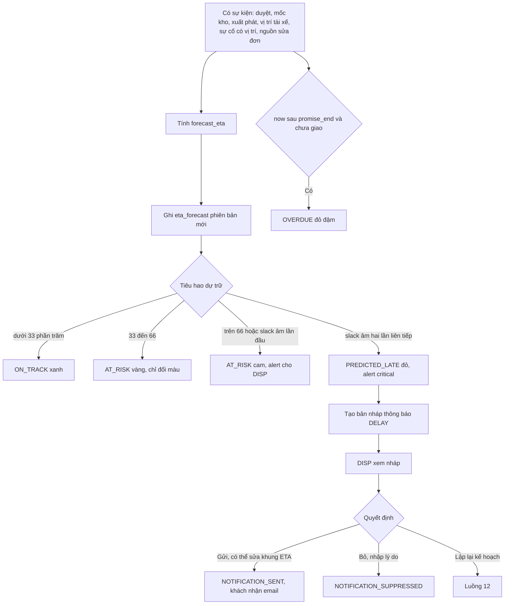

**Quy tắc:** chỉ DISP gửi báo trễ; sau khi gửi, bản nháp mới chỉ xuất hiện khi `forecast_eta` lệch ≥ 30 phút so với khung đã thông báo; ETA chỉ tính lại khi có sự kiện; quá ETA hoặc mốc kho 30 phút không có sự kiện → alert `OVERDUE` (không tính lại ETA); khách chỉ nhận trạng thái và ETA.

## 11. Vòng đời thông báo

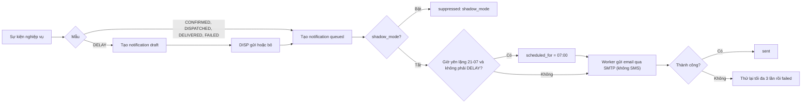

Mỗi thông báo có `dedupe_key` theo (đơn, mẫu, trạng thái). Nội dung dựng từ mẫu ở `03` mục 6; người nhận hiển thị đã che.

## 12. Luồng giao thất bại và lập lại (R3, DEC-R3-09)

**Tác nhân:** DRV, SYS, DISP · **Quy tắc:** BR-EXE-02

1. DRV ghi `FAILED` + lý do chuẩn + vị trí cho chuyến của mình; CFO lưu kết quả chuyến. Đơn `FAILED` khi mọi chuyến của đơn đã kết thúc và có ít nhất một chuyến thất bại; email `FAILED` cho khách; alert `DELIVERY_FAILED` cho DISP kèm lý do và kết quả từng chuyến. **CFO dừng ở cảnh báo**, không tự chạy planner.
2. DISP chọn cách xử lý: khách vắng → ghi thỏa thuận ngày rồi Apply (luồng 6); xe hỏng hoặc cần đổi ngày → **Replan this order** (lý do bắt buộc), với đơn đã giao một phần thì `scope=remaining` chỉ lập cho phần hàng chưa giao; hoặc hủy có lý do. Trong **một transaction**: kế hoạch cũ → `superseded`, giữ chỗ còn lại → `released`, ngày cam kết xóa (ghi nhật ký) → đơn `SUBMITTED` → luồng 4. POD đã có được giữ nguyên.
3. Đơn FAILED không nằm trong mẫu số "đúng hạn".
4. Lập lại một đơn **đã duyệt** vì thay đổi lớn: cùng thao tác; `trip_stop`/`delivery_trip` chưa xong → `cancelled` trước khi chạy lại. Khi duyệt kế hoạch mới, khách nhận `CONFIRMED` mới.
5. Hủy đơn (trước `DISPATCHED`) đóng kế hoạch, giữ chỗ, chuyến giống bước 4; đơn → `CANCELLED`. Chỉ Dispatcher; Sales → 403.

## 12a. Luồng đơn lớn hơn một xe (nhiều xe, một kho)

**Tác nhân:** SYS, DISP, WH, DRV · **Màn:** Plan review (5.2), Prep queue (5.6), Driver (5.10) · **Quy tắc:** FR-ORD-05, BR-DEL-05, BR-RNK-02

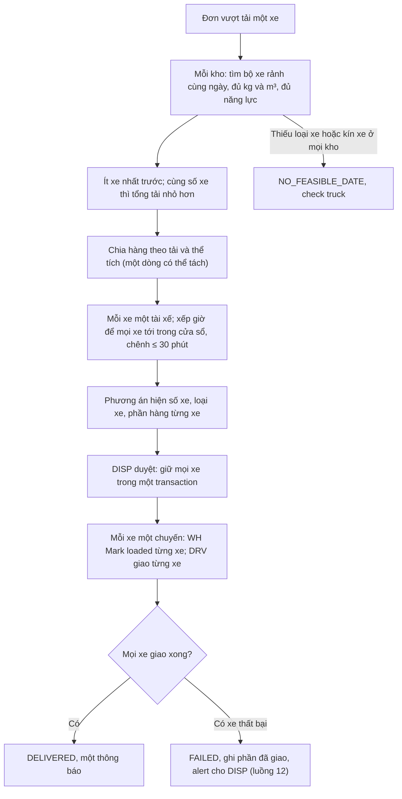

Không ghép đơn: một xe chỉ chở một đơn trong một chuyến. Không giới hạn số xe (chỉ bị giới hạn bởi xe và tài xế rảnh). Thông báo: một `CONFIRMED`, `DISPATCHED` khi xe đầu tiên xuất phát, `DELIVERED` khi xe cuối giao xong.

## 12b. Luồng gợi ý lập lại tự động

**Tác nhân:** SYS, DISP · **Màn:** Order queue (alert), Plan review (5.2) · **Quy tắc:** FR-APR-05, BR-APR-04

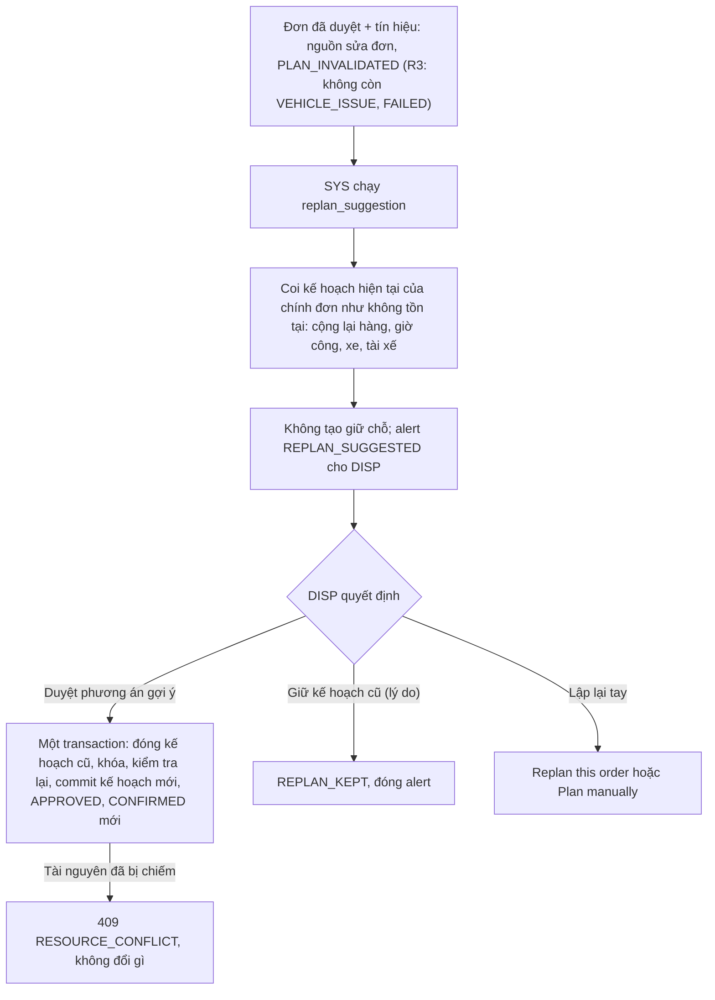

Không bao giờ tự duyệt. Đơn đã `DISPATCHED` chỉ nhận alert.

## 13. Luồng đơn thay đổi sau khi duyệt

1. SYS nhận phiên bản mới của đơn đã `APPROVED` từ nguồn (sửa số lượng, ngày, địa chỉ, hủy).
2. SYS **không ghi đè**; tạo alert `ORDER_CHANGED_AFTER_APPROVAL` kèm khác biệt và **tự gợi ý phương án mới** theo bản mới (luồng 12b).
3. DISP xem khác biệt và chọn: **duyệt phương án gợi ý**, **Keep current plan** (ghi lý do, đóng alert) hoặc **Cancel** (nếu nguồn hủy).
4. Đơn đã `DISPATCHED`: chỉ alert, không đổi trạng thái; DISP xử lý ngoài hệ thống.

## 14. Luồng đồng bộ dữ liệu và dữ liệu cũ

**Tác nhân:** SYS, IT · **Màn:** Data integration (5.9)

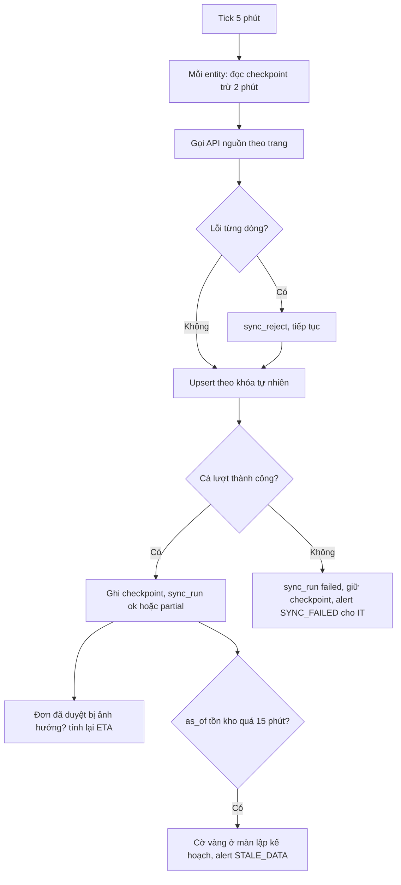

IT xem lượt chạy, dòng bị loại và có thể chạy tay (`/sync/{entity}/run`); **Upload CSV (fallback)** đi qua `CsvMarketAdapter` với kiểm tra hash để tránh nạp trùng.

## 15. Luồng CSKH tra cứu (R3: không ghi liên hệ)

**Tác nhân:** CS · **Màn:** Order lookup (5.A14)

1. Khách gọi; CS tìm theo mã đơn, tên khách hoặc điện thoại.
2. CS xem trạng thái, khung giờ cam kết, ETA hiện tại, lịch sử thông báo (không vị trí, không điểm số).
3. CS trả lời khách. Không có nhật ký liên hệ trong CFO (DEC-R3-05).
4. Nếu khách yêu cầu đổi ngày hoặc khiếu nại cần quyết định: CS chuyển cho DISP; CS **không** sửa kế hoạch, không gửi báo trễ.

## 16. Luồng thêm nước mới (IT)

1. IT chạy `tools/add_market.py <CC>` → dòng `ref.market`, bảng `ref.product_<cc>`, cập nhật view `ref.v_product_local`.
2. Cấu hình `MarketConfig` (ngày làm việc, giờ nhận hàng, giờ cắt, ngày lễ, ngôn ngữ, múi giờ, tiền tệ) trong màn Market config; `shadow_mode = true`.
3. Cấu hình `source_base_url` và khóa; nếu hệ thống nguồn không theo hợp đồng chuẩn thì viết lớp con của `RestMarketAdapter`.
4. Chạy đồng bộ sản phẩm → hàng đợi mapping → IT ánh xạ.
5. Chạy bóng (`shadow_mode`): dispatcher vẫn quyết định; không gửi thông báo cho khách; đo baseline và KPI.
6. Go-live: tắt `shadow_mode`, huấn luyện, dispatcher giữ quyền duyệt cuối; chỉ sang nước tiếp theo khi KPI đạt và quyền truy cập dữ liệu được xác nhận. Không sửa lõi ở bất kỳ bước nào.

## 17. Sơ đồ trạng thái đơn hàng

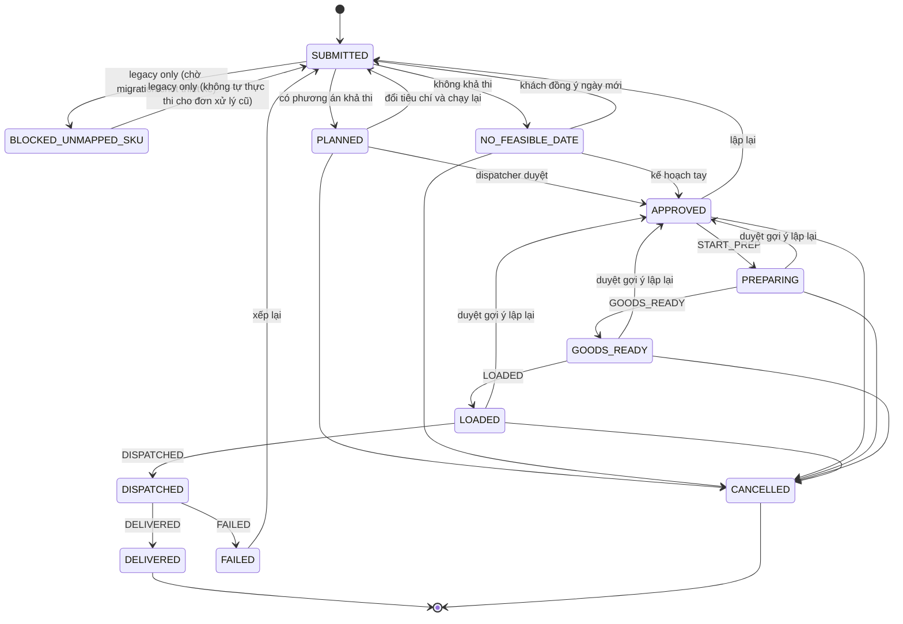

## 18. Ma trận điều hướng theo vai trò (điểm vào mặc định và bước tiếp)

| Vai trò | Sau đăng nhập | Việc thường gặp nhất | Bước tiếp thường dẫn đến |
|---|---|---|---|
| Dispatcher | Order queue | Mở đơn `PLANNED` → Plan review → Approve | Danh sách chuyến được gán (dòng vị trí gần nhất) khi có cảnh báo; Exceptions khi có đơn không khả thi |
| Warehouse | Prep queue | Xác nhận công suất ngày → bấm mốc chuẩn bị → báo ngoại lệ | Công suất ngày |
| Driver | Today's trips | Mark dispatched → Cập nhật vị trí / Báo sự cố → Delivered/Failed (kèm vị trí) | — |
| Sales | My store orders / Sync & confirm trong CFO | Submit ở POS cũ, sync-now, check feasibility, chọn rank 1–3 và duyệt | Thành công → APPROVED; không khả thi → Dispatcher |
| Store manager | My store orders | Theo dõi đơn; xem Đơn hàng & doanh thu cửa hàng mình nếu là owner | Đơn hàng & doanh thu · my location |
| Customer service | Order lookup | Tra cứu trạng thái và ETA | — |
| IT/Admin | Data integration | Xử lý hàng đợi mapping, đồng bộ lỗi | Product mapping, Handling groups |
| Business owner (`revenue_all`) | Đơn hàng & doanh thu | Doanh thu, số đơn theo 6 nhóm trạng thái, lọc theo kỳ, xuất CSV | — |
| Project lead (`ops`) | KPIs & decision log | Xem KPI vận hành và nhật ký | — |

## 19. Tình huống ngoại lệ thường gặp và cách hệ thống phản ứng

| Tình huống | Phản ứng |
|---|---|
| Hai dispatcher duyệt cùng lúc hai đơn tranh một xe | Một thành công; người còn lại nhận `409 RESOURCE_CONFLICT` và nút Re-run plan |
| Hai đơn cùng tranh một lượng hàng (cùng kho, cùng SKU) hoặc cùng giờ công một ngày | Lúc lập kế hoạch cả hai được giữ chỗ (cho phép vượt); khi duyệt khóa theo (kho, sản phẩm) / (kho, ngày): đơn duyệt trước thắng, đơn sau nhận `409 RESOURCE_CONFLICT` |
| Đơn lớn hơn một xe | Tự xếp nhiều xe cùng kho, ít xe nhất (luồng 12a) |
| Thiếu loại xe cần (cẩu, ben) hoặc kín xe | `NO_FEASIBLE_DATE` (check `truck`); DISP thương lượng ngày, lập tay hoặc hủy |
| Hold hết hạn trong lúc dispatcher đang xem | Chip đỏ; Approve vẫn kiểm tra lại và thành công nếu tài nguyên còn trống |
| Tồn kho nguồn đổi sau khi duyệt | Kiểm tra lại các đơn đã duyệt bị ảnh hưởng; nếu kế hoạch không còn hợp lệ → alert `PLAN_INVALIDATED` + gợi ý phương án mới (luồng 12b) |
| Xe hỏng sau khi duyệt | `VEHICLE_ISSUE` → alert + gợi ý phương án mới (luồng 12b) |
| Tài xế mất mạng | Sự kiện xếp hàng, gửi lại một lần |
| ORS lỗi hoặc hết quota | Dùng ước lượng fallback có nhãn "Estimated route" (hoặc loại cặp nếu `routing.allow_fallback = false`) |
| Nguồn lỗi | `sync_run failed`, giữ checkpoint, alert IT; dispatcher thấy cờ dữ liệu cũ sau 15 phút |
| SMTP lỗi | Thử lại 3 lần rồi `failed`; DISP thấy trạng thái trong Notification inbox |
| Khách không liên lạc được khi thương lượng ngày | `unreachable`, nhắc sau 24 giờ |
